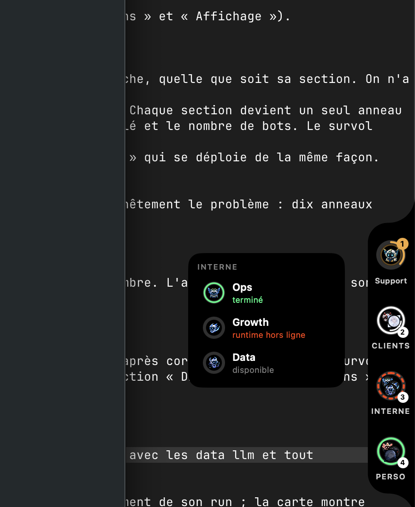
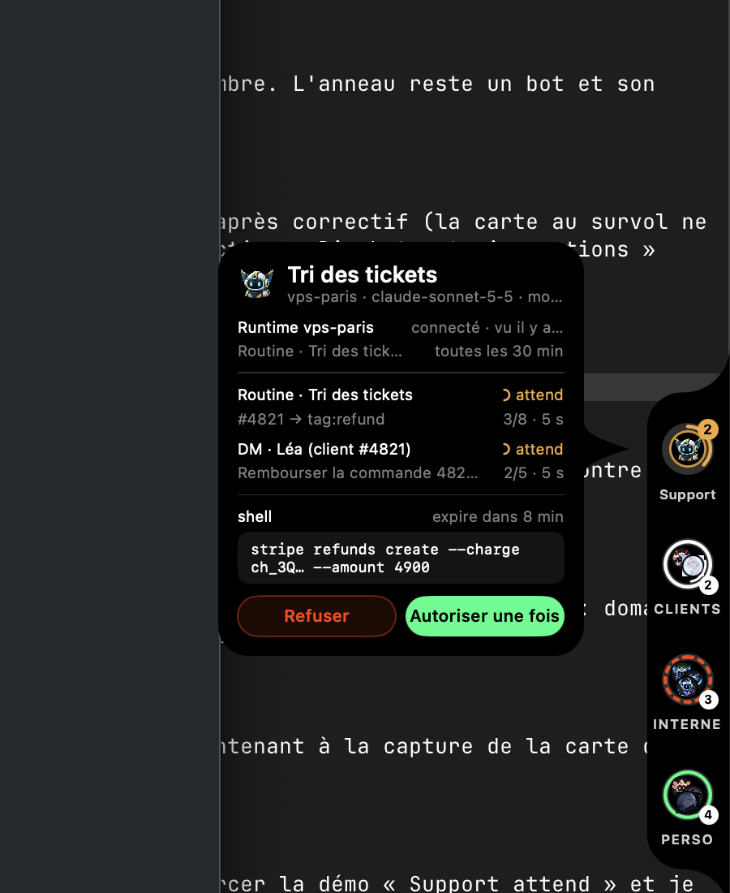
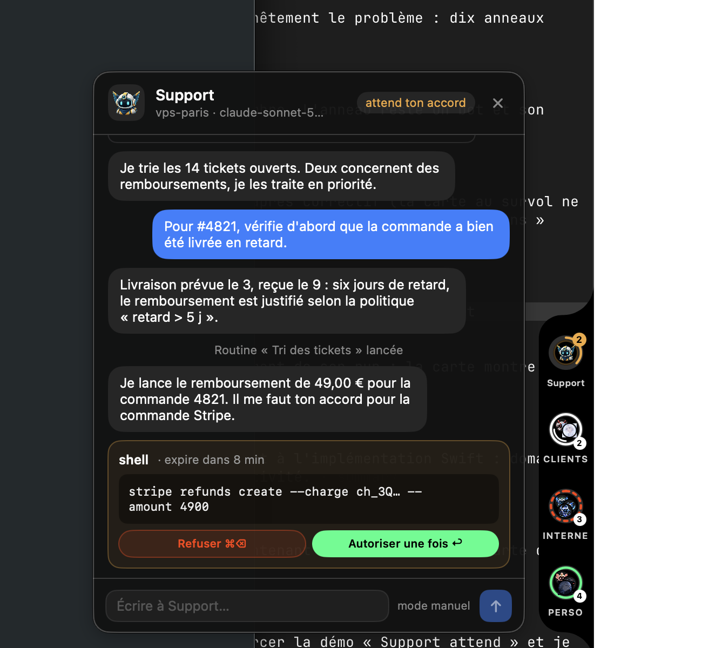

# openedbot notch

[](LICENSE)


A prototype macOS notch UI for [openedbot](https://openedbot.app): your bots live in a small
black notch attached to an edge of the screen. One ring per bot shows who is working and how far
along the run is, who is waiting for your approval, and which runtime went down. Hover for details,
click to open the agent window: read the thread, approve or deny, reply. No need to open the console.

> **Status: prototype.** Out of the box it runs on **mock data**: ten demo bots in three sections,
> two scripted runs that loop, and a runtime that drops. It is not a supported openedbot product.

| Sections, one tray per pile | Bot card (hover) | Agent window (click) |
|---|---|---|
|  |  |  |

## Where it fits

| Component | Role |
|---|---|
| **openedbot-notch** (this repo) | Prototype macOS notch UI, runs standalone on mock data |
| openedbot desktop app ([`apps/desktop`](https://github.com/OpenedBot/openedbot/tree/main/apps/desktop) in OpenedBot/openedbot) | Embeds this bundle on macOS and runs it in hosted mode |
| openedbot console | The web console the notch can optionally sign in to |
| edge-setup | Host-side installer and connector for the agents openedbot drives |

## Features

- **One ring per bot**: avatar in the centre, run progress as an arc coloured by state
  (running, awaiting approval, completed, runtime offline), amber badge when an approval waits.
- **Hover card**: bot, runtime, model, permission mode, routines, current runs, pending approval
  with *Deny* / *Allow once*.
- **Agent window**: thread (messages, tool calls), inline approval, composer. One window per agent.
- **Many bots**: bots waiting for approval are promoted; sections collapse into piles that expand
  into a tray on hover; an "active only" mode.
- **Announcements**: the notch opens briefly and plays a sound when a run finishes, a bot waits,
  or a runtime drops.
- **YOLO badge** (signed in, camera-notch island): a red `YOLO` badge and a countdown while a
  YOLO lease auto-approves a bot's writes on the host, and *Turn YOLO off everywhere* in the
  expanded island. See [YOLO leases](#yolo-leases).
- **Menu bar item**, four screen edges, settings window, English and French UI.

An interactive HTML mockup of the design lives in [`design/index.html`](design/index.html)
(open it in a browser, no build needed).

## Requirements

- macOS 15 or later
- Swift 6 toolchain (Xcode 16+; developed with Xcode 27 / Swift 6.4)
- No third-party dependencies

## Quick start

```sh
make dev     # swift run OHBPopup (fastest loop, no .app bundle)
make test    # swift test
make run     # release build, bundle dist/OHBPopup.app, open it
```

`make build` / `make bundle` sign the binary with a local self-signed identity created by
`scripts/dev-sign.sh` (stored in a dedicated keychain under `~/Library/Keychains`), so the
Keychain does not prompt again after every rebuild. The first run asks macOS to trust that
certificate for code signing. The app has no Dock icon (`LSUIElement`): use the notch and the
menu bar item.

| Command | What it does |
|---|---|
| `make dev` | `swift run OHBPopup`, no `.app` bundle |
| `make build` | Release build, signed with the local dev identity |
| `make bundle` | Build `dist/OHBPopup.app` |
| `make run` | Bundle and open the app |
| `make test` | `swift test` |
| `make clean` | Remove build artefacts |

## Connecting to openedbot (experimental)

Without an account the notch shows the demo bots. *Settings › Account* can sign in to an
openedbot server (default origin `https://openedbot.app`, HTTPS only except local/lab hosts)
with the native PKCE flow; the session is kept in the macOS Keychain, never in `UserDefaults`.
This path is experimental and not guaranteed to work against current servers.

### YOLO leases

openedbot's YOLO mode issues signed, time-limited leases that auto-approve a bot's writes on the
host. When signed in (standalone or hosted), the notch reads them with the same client as the
feed (bearer token, `X-OHB-Organization`, one replay after a 401) and shows them in the island:

- **Compact island**: a red `YOLO` badge and the time left (`m:ss`, `h:mm:ss` past an hour) as
  soon as one lease is active, even with no bot working.
- **Expanded island**: the number of active leases, what the displayed lease covers (whole
  runtime, a bot, a thread of a bot), and *Turn YOLO off everywhere*. The button asks for an
  inline confirmation, then calls the kill route. A `403` says only owners and admins can do
  it; any other failure is shown in the strip and written to *Settings › Journal*.

The contract the notch reads (the reference is `apps/desktop/README.md` in OpenedBot/openedbot):

| Route | Notch behaviour |
|---|---|
| `GET /api/organization/yolo/leases` | Polled every 30 s, and again just after the soonest `expiresAt`. `404`: the server has no YOLO, nothing shown. Other failures keep the last known leases (minus the expired ones) rather than hiding YOLO. |
| `POST /api/organization/yolo/kill` | Body `{}`, response body ignored. Success clears the badge, then the leases are read again: the server has the last word. |

Lease parsing is tolerant (`Sources/OHBPopup/Model/Yolo.swift`):

- The response is `{ "leases": [...] }`, `{ "items": [...] }` or a bare array; an element that is
  not an object is skipped, not the whole response.
- Each lease reads `leaseId` (or `id`), `scope` (`thread`, `bot`, `runtime`, case-insensitive;
  anything else counts as an active lease of unknown scope), `botId`, `threadId`, `runtimeId`,
  `expiresAt`. Other fields are ignored.
- `expiresAt` is ISO 8601 (with or without fractional seconds, `Z` or an offset) or an epoch, as
  a number or a numeric string. An epoch of 10^11 or more is read as milliseconds, otherwise
  as seconds (10^11 seconds is the year 5138, 10^11 milliseconds is 1973). A missing or
  unreadable `expiresAt` keeps the lease active with no countdown, until the server drops it.
- The badge shows the lease that ends **last** (YOLO stays on until then); a lease with no
  deadline wins; on a tie, the broadest scope (runtime, bot, thread), then the lease id.
- The countdown runs against the server's `expiresAt` using the Mac's clock (no skew
  correction) and is rounded up: `0:01` until the last second, then the lease drops.

The demo (signed out) never shows YOLO. The hosted-mode protocol is unchanged.

The executable and module are still named `OHBPopup` internally (bundle id
`app.openedbot.popup`), because the openedbot desktop app embeds the bundle under that name and
launches it with `--hosted`.

### Embedding in the desktop app

The desktop app's `make package-mac` (in OpenedBot/openedbot) looks for this repository's bundle in
a checkout next to its own, `../openedbot-notch` from its root (`NOTCH_DIR=/path/to/openedbot-notch`
otherwise):

```sh
make bundle    # dist/OHBPopup.app, with OHBHostedProtocol 1 in its Info.plist
```

The hosted-mode protocol (`Sources/OHBPopup/Host/HostProtocol.swift`) mirrors
[`apps/desktop/src/shared/popup-protocol.ts`](https://github.com/OpenedBot/openedbot/blob/main/apps/desktop/src/shared/popup-protocol.ts),
which is the reference: change both sides together.

## Configuration

No environment variables are needed to run it. In the app, *Settings* has pages for General, Account, Models, Journal,
Notch, Menu bar, Announcements and Demo. For tests, `OPENEDBOT_SNAPSHOT_DIR` enables the
PNG snapshots (see [Testing](#testing)).

## Testing

```sh
make test                                                  # swift test
OPENEDBOT_SNAPSHOT_DIR=/tmp/notch-ui swift test --filter Snapshot  # render views to PNG, no windows
```

## Project structure

```text
Sources/OHBPopup
├── App/     entry point, app delegate, menu bar, settings pages
├── Auth/    native sign-in client, Keychain session, token sources
├── Design/  metrics, palette, typography, Markdown rendering
├── Feed/    REST + SSE client, DTOs, mapping to notch models
├── Host/    hosted-mode stdio protocol
├── Model/   domain models, geometry, layout rules, mock feed
└── Notch/   notch panel, rings, cards, agent window
Tests/OHBPopupTests   unit tests (geometry, layout rules, mock feed, auth, host protocol, YOLO leases)
Resources/            Info.plist, bot artworks, faces, provider marks
design/               static HTML mockup
```

## Documentation

- Website: <https://openedbot.app>
- Documentation: <https://docs.openedbot.app>

## Contributing

This is a prototype published for reference. Issues and pull requests are welcome; please keep
changes small and run `make test` before opening one. Every pull request and push to `main`
is scanned by gitleaks (`gitleaks git . -c .gitleaks.toml`).

## License

Licensed under the [Apache License 2.0](LICENSE). Copyright 2026 Kévin Aubrée.

Provider logos in `Resources/brand-marks.json` come from [Simple Icons](https://simpleicons.org)
(CC0-1.0); the brands themselves belong to their owners.
